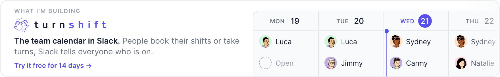

# Hi, I'm Vincent 👋

<a href="https://turnshift.app/?utm_source=github&utm_medium=profile&utm_campaign=vvo">
  <picture>
    <source media="(prefers-color-scheme: dark)" srcset="./turnshift-dark.png">
    
  </picture>
</a>

I build [TurnShift](https://turnshift.app/?utm_source=github&utm_medium=profile&utm_campaign=vvo), a team calendar in Slack. People book their shifts or take turns, and Slack tells everyone who is on.

Open source I made, all sponsored by TurnShift:

- [iron-session](https://github.com/vvo/iron-session): secure, stateless, cookie-based sessions for JavaScript.
- [tzdb](https://github.com/vvo/tzdb): always up to date time zones for time zone pickers.
- [gifify](https://github.com/vvo/gifify): convert any video file to an optimized animated GIF.
- [lazyload](https://github.com/vvo/lazyload): lazyload images and iframes until they are visible.
